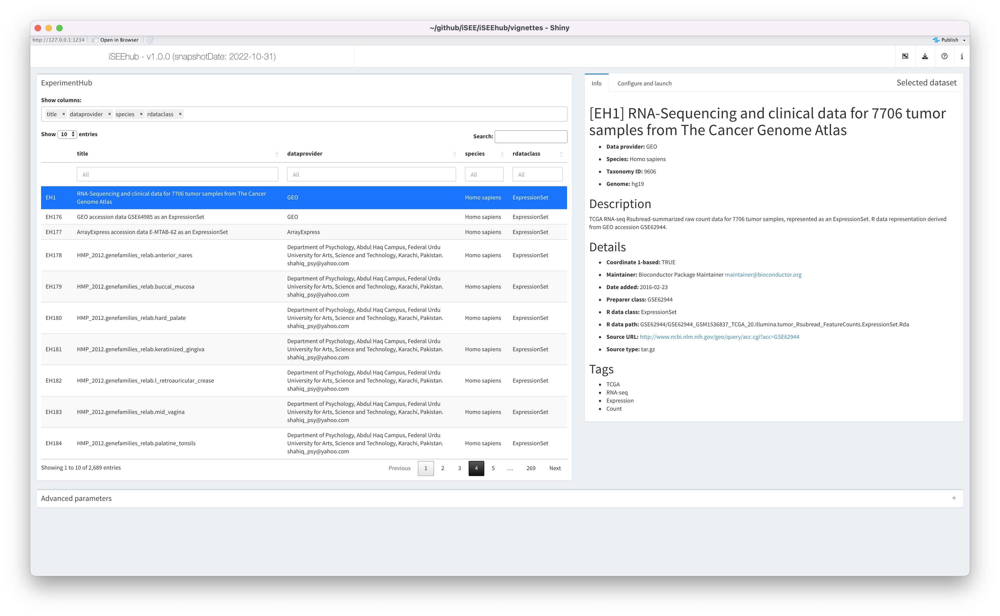
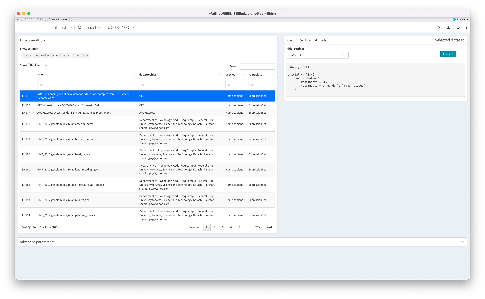
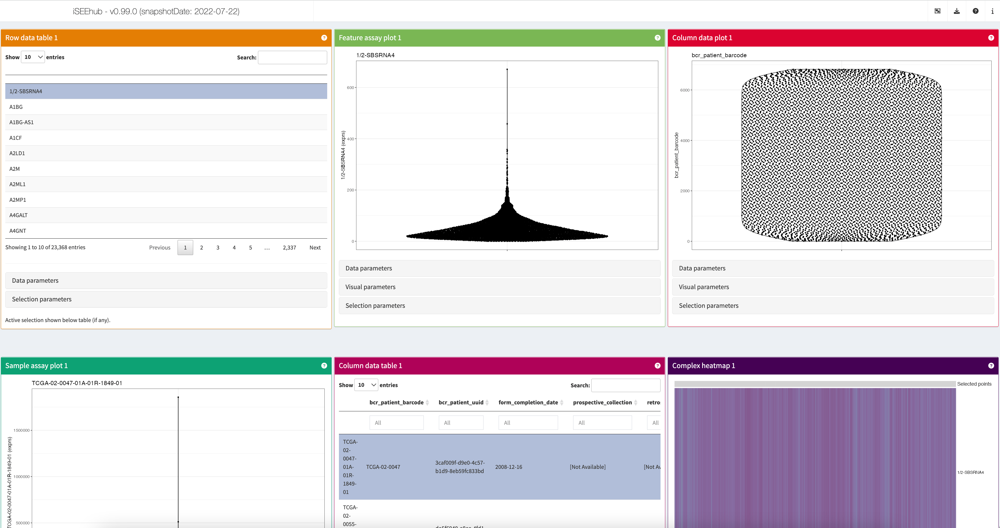
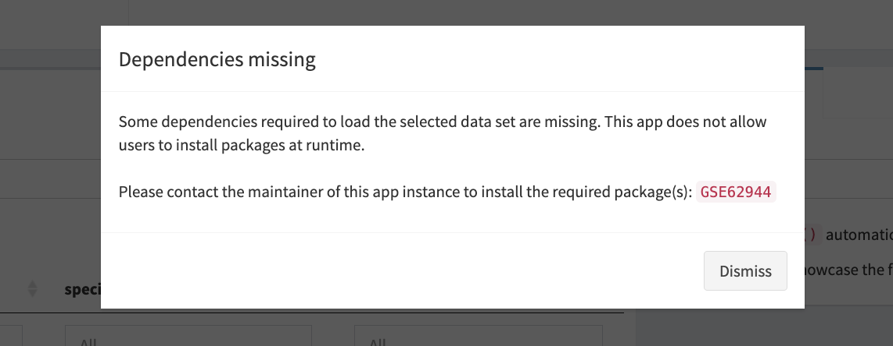
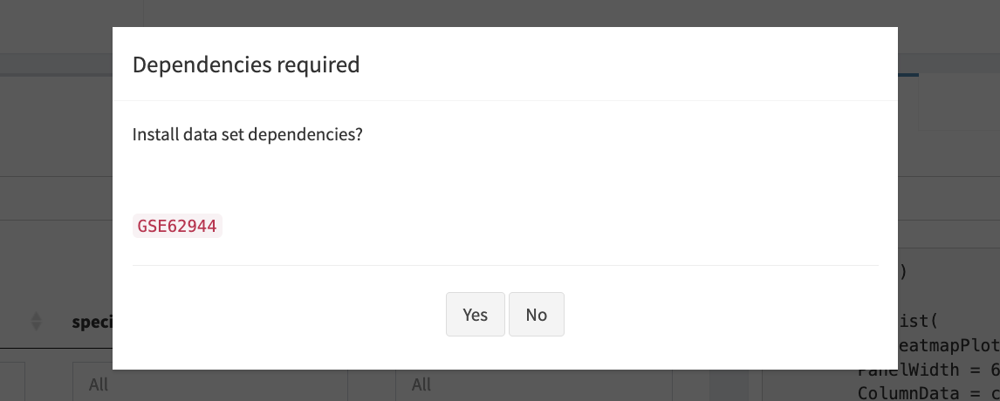

# Introduction to iSEEhub

## Introduction

*[iSEEhub](https://bioconductor.org/packages/3.24/iSEEhub)* is an
extension to the *[iSEE](https://bioconductor.org/packages/3.24/iSEE)*
*Bioconductor* package that provides a link between
*[iSEE](https://bioconductor.org/packages/3.24/iSEE)* and the
*Bioconductor*
*[ExperimentHub](https://bioconductor.org/packages/3.24/ExperimentHub)*.

Specifically,
*[iSEEhub](https://bioconductor.org/packages/3.24/iSEEhub)* adds a
custom landing page to
*[iSEE](https://bioconductor.org/packages/3.24/iSEE)* web applications
that can be used to browse the *Bioconductor*
*[ExperimentHub](https://bioconductor.org/packages/3.24/ExperimentHub)*
interactively, and loads a selected data set in the standard
*[iSEE](https://bioconductor.org/packages/3.24/iSEE)* user interface.

## Basics

### Install `iSEEhub`

*R* is an open-source statistical environment which can be easily
modified to enhance its functionality via packages.
*[iSEEhub](https://bioconductor.org/packages/3.24/iSEEhub)* is a *R*
package available via the [Bioconductor](http://bioconductor.org)
repository for packages. *R* can be installed on any operating system
from [CRAN](https://cran.r-project.org/) after which you can install
*[iSEEhub](https://bioconductor.org/packages/3.24/iSEEhub)* by using the
following commands in your *R* session:

\
`if`` ``(``!`[`requireNamespace`](https://rdrr.io/r/base/ns-load.html)`(``"BiocManager"``, quietly ``=`` ``TRUE``)``)`` ``{`\
`      `[`install.packages`](https://rdrr.io/r/utils/install.packages.html)`(``"BiocManager"``)`\
`  ``}`\
\
`BiocManager``::`[`install`](https://bioconductor.github.io/BiocManager/reference/install.html)`(``"iSEEhub"``)`\
\
`## Check that you have a valid Bioconductor installation`\
`BiocManager``::`[`valid`](https://bioconductor.github.io/BiocManager/reference/valid.html)`(``)`

### Required knowledge

*[iSEEhub](https://bioconductor.org/packages/3.24/iSEEhub)* is based on
many other packages that have implemented the infrastructure needed for
dealing with omics data and interactive visualisation. That is, packages
like
*[SummarizedExperiment](https://bioconductor.org/packages/3.24/SummarizedExperiment)*,
*[SingleCellExperiment](https://bioconductor.org/packages/3.24/SingleCellExperiment)*,
*[iSEE](https://bioconductor.org/packages/3.24/iSEE)* and
*[shiny](https://bioconductor.org/packages/3.24/shiny)*.

If you are asking yourself the question “Where do I start using
Bioconductor?” you might be interested in [this blog
post](http://lcolladotor.github.io/2014/10/16/startbioc/#.VkOKbq6rRuU).

### Asking for help

As package developers, we try to explain clearly how to use our packages
and in which order to use the functions. But *R* and *Bioconductor* have
a steep learning curve so it is critical to learn where to ask for help.
The blog post quoted above mentions some but we would like to highlight
the [Bioconductor support site](https://support.bioconductor.org/) as
the main resource for getting help: remember to use the `iSEEhub` tag
and check [the older
posts](https://support.bioconductor.org/t/iSEEhub/). Other alternatives
are available such as creating GitHub issues and tweeting. However,
please note that if you want to receive help you should adhere to the
[posting
guidelines](http://www.bioconductor.org/help/support/posting-guide/). It
is particularly critical that you provide a small reproducible example
and your session information so package developers can track down the
source of the error.

### Citing `iSEEhub`

We hope that *[iSEEhub](https://bioconductor.org/packages/3.24/iSEEhub)*
will be useful for your research. Please use the following information
to cite the package and the overall approach. Thank you!

\
`## Citation info`\
[`citation`](https://rdrr.io/r/utils/citation.html)`(``"iSEEhub"``)`\
`#> To cite package 'iSEEhub' in publications use:`\
`#> `\
`#>   Rue-Albrecht K (2024). _iSEEhub: iSEE for the Bioconductor`\
`#>   ExperimentHub_. R package version 1.15.0,`\
`#>   <https://github.com/iSEE/iSEEhub>.`\
`#> `\
`#> A BibTeX entry for LaTeX users is`\
`#> `\
`#>   @Manual{,`\
`#>     title = {iSEEhub: iSEE for the Bioconductor ExperimentHub},`\
`#>     author = {Kevin Rue-Albrecht},`\
`#>     year = {2024},`\
`#>     note = {R package version 1.15.0},`\
`#>     url = {https://github.com/iSEE/iSEEhub},`\
`#>   }`

Here is an example of you can cite your package inside the vignette:

- *[iSEEhub](https://bioconductor.org/packages/3.24/iSEEhub)*
  (Rue-Albrecht, 2024)

## Quick start to using to `iSEEhub`

The main functionality of the package is available through the function
[`iSEEhub()`](https://isee.github.io/iSEEhub/reference/iSEEhub.md).

The function returns a
*[shiny](https://bioconductor.org/packages/3.24/shiny)* app that can
then be launched using the function
[`shiny::runApp()`](https://rdrr.io/pkg/shiny/man/runApp.html).

\
[`library`](https://rdrr.io/r/base/library.html)`(`[`iSEEhub`](https://github.com/iSEE/iSEEhub)`)`\
[`library`](https://rdrr.io/r/base/library.html)`(`[`ExperimentHub`](https://github.com/Bioconductor/ExperimentHub)`)`\
`ehub`` ``<-`` `[`ExperimentHub`](https://rdrr.io/pkg/ExperimentHub/man/ExperimentHub-class.html)`(``)`\
\
`app`` ``<-`` `[`iSEEhub`](https://isee.github.io/iSEEhub/reference/iSEEhub.md)`(``ehub``)`\
\
`if`` ``(`[`interactive`](https://rdrr.io/r/base/interactive.html)`(``)``)`` ``{`\
`  ``shiny``::`[`runApp`](https://rdrr.io/pkg/shiny/man/runApp.html)`(``app``, port ``=`` ``1234``)`\
`}`

## The ExperimentHub pane

Datasets available in the *Bioconductor*
*[ExperimentHub](https://bioconductor.org/packages/3.24/ExperimentHub)*
are listed – along with metadata – in the interactive table on the left.

The table may be filtered and sorted using any metadata column, to
efficiently browse the datasets available.

By default, only a subset of metadata columns are displayed. The
selectize input labelled `Show columns:` at the top of the pane may be
used to add, remove, or reorder columns in the table.

No more than one dataset may be selected at any time.

## The Selected Dataset pane

### Overview

The pane on the right updates with the currently selected dataset.

This pane contains information and inputs required to load the currently
selected dataset in the main
*[iSEE](https://bioconductor.org/packages/3.24/iSEE)* app.

The pane is composed of two tabs described in the following sections.

### The Info tab

The `Info` tab displays the full metadata associated with the currently
selected dataset – the same metadata as in the `ExperimentHub` table –
in formatted text.

As such, users can uses a minimal subset of columns in the table to
efficiently browse available datasets, while having a full overview of
the currently selected dataset in this tab.

### The Config tab

The `Config` tab displays a selectize input offering users a choice of
initial app configurations that are specific to the currently selected
dataset.

For all datasets, an option `Default` is available. That option does not
provide any specific instruction with respect to the initial set of
panels, their layout, nor their respective initial settings. Instead,
the `Default` option prompts the app to automatically identify all the
built-in *[iSEE](https://bioconductor.org/packages/3.24/iSEE)* panel
classes that are compatible with the loaded dataset, initialising an app
that contains one instance of each of those panels.

The number of panels and data points to draw for large datasets makes
the `Default` option a showcase mode for demonstration and for new
users, more than one optimised for a short loading time or featuring
specific aspects of the dataset.

For some datasets, additional choices of initial settings are available.
Configurations are provided as scripts that define the list of panels
and their respective initial configuration when the main
*[iSEE](https://bioconductor.org/packages/3.24/iSEE)* app is launched.

To contribute new scripts, please refer to the vignette [Contributing to
iSEEhub](https://isee.github.io/iSEEhub/articles/contributing.md).

For demonstration, a simple example `config_1.R` is included for the
dataset `EH1`. When selected, the contents of the configuration file are
shown in the pane – including any comment from the authors – allowing
users to review the script before using it.

When the appropriate configuration is selected, users may click the
`Launch!` button to load the dataset into the main
*[iSEE](https://bioconductor.org/packages/3.24/iSEE)* app.

## The main iSEE app

Once the dataset is successfully loaded into the *R* session, the app
will switch to the main
*[iSEE](https://bioconductor.org/packages/3.24/iSEE)* view.

## Managing dataset dependencies

### Overview

Each dataset in the Bioconductor
*[ExperimentHub](https://bioconductor.org/packages/3.24/ExperimentHub)*
is associated with package dependencies that are required to handle the
dataset in an *R* session. Package dependencies must be installed in the
*R* library before the corresponding dataset can be loaded.

The list of packages associated with all datasets types supported by
*[iSEEhub](https://bioconductor.org/packages/3.24/iSEEhub)* is regularly
updated in the `Suggests:` field of the `DESCRIPTION` file. However,
those packages are not automatically installed in a minimal installation
of the *[iSEEhub](https://bioconductor.org/packages/3.24/iSEEhub)*
package.

### From the *R* console

By default, `iSEEhub(..., runtime_install = FALSE)` prevents the app
from installing those dependencies at runtime. In that case, when users
identify a missing dependency, they must interrupt the app, install the
required package(s) using the *R* console, and re-launch the app. We
recommend this approach for applications hosted on public web-servers.

### From the live app

Alternatively, `iSEEhub(..., runtime_install = TRUE)` can be used to
launch an app that prompts users interactively (i.e., within the app)
for their consent to install missing dependencies. We recommend this
approach for applications run on personal computers (unless users prefer
to install packages themselves, of course).

## Reproducibility

The *[iSEEhub](https://bioconductor.org/packages/3.24/iSEEhub)* package
(Rue-Albrecht, 2024) was made possible thanks to:

- R (R Core Team, 2026)
- *[BiocStyle](https://bioconductor.org/packages/3.24/BiocStyle)* (Oleś,
  2026)
- *[knitr](https://CRAN.R-project.org/package=knitr)* (Xie, 2026)
- *[RefManageR](https://CRAN.R-project.org/package=RefManageR)* (McLean,
  2017)
- *[rmarkdown](https://CRAN.R-project.org/package=rmarkdown)* (Allaire,
  Xie, Dervieux, McPherson, Luraschi, Ushey, Atkins, Wickham, Cheng,
  Chang, and Iannone, 2026)
- *[sessioninfo](https://CRAN.R-project.org/package=sessioninfo)*
  (Wickham, Chang, Flight, Müller, and Hester, 2026)
- *[testthat](https://CRAN.R-project.org/package=testthat)* (Wickham,
  2011)

This package was developed using
*[biocthis](https://bioconductor.org/packages/3.24/biocthis)*.

Code for creating the vignette

\
`## Create the vignette`\
[`library`](https://rdrr.io/r/base/library.html)`(`[`"rmarkdown"`](https://github.com/rstudio/rmarkdown)`)`\
[`system.time`](https://rdrr.io/r/base/system.time.html)`(`[`render`](https://pkgs.rstudio.com/rmarkdown/reference/render.html)`(``"iSEEhub.Rmd"``, ``"BiocStyle::html_document"``)``)`\
\
`## Extract the R code`\
[`library`](https://rdrr.io/r/base/library.html)`(`[`"knitr"`](https://yihui.org/knitr/)`)`\
[`knit`](https://rdrr.io/pkg/knitr/man/knit.html)`(``"iSEEhub.Rmd"``, tangle ``=`` ``TRUE``)`

Date the vignette was generated.

    #> [1] "2026-10-22 13:57:40 UTC"

Wallclock time spent generating the vignette.

    #> Time difference of 8.708 secs

*R* session information.

    #> ─ Session info ───────────────────────────────────────────────────────────────────────────────────────────────────────
    #>  setting  value
    #>  version  R version 4.6.1 (2026-06-24)
    #>  os       Ubuntu 24.04.5 LTS
    #>  system   x86_64, linux-gnu
    #>  ui       X11
    #>  language en
    #>  collate  en_US.UTF-8
    #>  ctype    en_US.UTF-8
    #>  tz       UTC
    #>  date     2026-10-22
    #>  pandoc   3.12.1 @ /usr/bin/ (via rmarkdown)
    #>  quarto   1.10.18 @ /usr/local/bin/quarto
    #> 
    #> ─ Packages ───────────────────────────────────────────────────────────────────────────────────────────────────────────
    #>  package              * version date (UTC) lib source
    #>  abind                  1.4-8   2024-09-12 [1] RSPM (R 4.6.0)
    #>  AnnotationDbi          1.75.2  2026-07-21 [1] Bioconductor 3.24 (R 4.6.1)
    #>  AnnotationHub        * 4.3.2   2026-06-30 [1] Bioconductor 3.24 (R 4.6.1)
    #>  bibtex                 0.5.3   2026-09-22 [1] RSPM (R 4.6.0)
    #>  Biobase              * 2.73.2  2026-07-29 [1] Bioconductor 3.24 (R 4.6.1)
    #>  BiocBaseUtils          1.15.1  2026-05-10 [1] Bioconductor 3.24 (R 4.6.1)
    #>  BiocFileCache        * 3.3.0   2026-04-28 [1] Bioconductor 3.24 (R 4.6.1)
    #>  BiocGenerics         * 0.59.12 2026-08-11 [1] Bioconductor 3.24 (R 4.6.1)
    #>  BiocManager            1.30.27 2025-11-14 [2] CRAN (R 4.6.1)
    #>  BiocStyle            * 2.41.0  2026-04-28 [1] Bioconductor 3.24 (R 4.6.1)
    #>  BiocVersion            3.24.0  2026-04-28 [2] Bioconductor 3.24 (R 4.6.1)
    #>  Biostrings             2.81.9  2026-09-06 [1] Bioconductor 3.24 (R 4.6.1)
    #>  bit                    4.6.0   2025-03-06 [1] RSPM (R 4.6.0)
    #>  bit64                  4.8.6   2026-09-01 [1] RSPM (R 4.6.0)
    #>  blob                   1.3.0   2026-01-14 [1] RSPM (R 4.6.0)
    #>  bookdown               0.48    2026-08-28 [1] RSPM (R 4.6.0)
    #>  bslib                  0.12.0  2026-08-04 [2] RSPM (R 4.6.0)
    #>  cachem                 1.1.0   2024-05-16 [2] RSPM (R 4.6.0)
    #>  circlize               0.4.18  2026-04-04 [1] RSPM (R 4.6.0)
    #>  cli                    3.6.6   2026-04-09 [2] RSPM (R 4.6.0)
    #>  clue                   0.3-68  2026-03-26 [1] RSPM (R 4.6.0)
    #>  cluster                2.1.8.3 2026-07-30 [2] RSPM (R 4.6.0)
    #>  codetools              0.2-20  2024-03-31 [3] CRAN (R 4.6.1)
    #>  colorspace             2.1-4   2026-10-08 [1] RSPM (R 4.6.0)
    #>  colourpicker           1.3.0   2023-08-21 [1] RSPM (R 4.6.0)
    #>  ComplexHeatmap         2.29.0  2026-04-28 [1] Bioconductor 3.24 (R 4.6.1)
    #>  crayon                 1.5.3   2024-06-20 [2] RSPM (R 4.6.0)
    #>  curl                   8.1.0   2026-10-14 [2] RSPM (R 4.6.0)
    #>  DBI                    1.3.0   2026-02-25 [1] RSPM (R 4.6.0)
    #>  dbplyr               * 2.6.0   2026-06-17 [1] RSPM (R 4.6.0)
    #>  DelayedArray           0.39.8  2026-09-30 [1] Bioconductor 3.24 (R 4.6.1)
    #>  desc                   1.4.3   2023-12-10 [2] RSPM (R 4.6.0)
    #>  digest                 0.6.39  2025-11-19 [2] RSPM (R 4.6.0)
    #>  doParallel             1.0.17  2022-02-07 [1] RSPM (R 4.6.0)
    #>  dplyr                  1.2.1   2026-04-03 [1] RSPM (R 4.6.0)
    #>  DT                     0.34.0  2025-09-02 [1] RSPM (R 4.6.0)
    #>  evaluate               1.0.5   2025-08-27 [2] RSPM (R 4.6.0)
    #>  ExperimentHub        * 3.3.2   2026-08-12 [1] Bioconductor 3.24 (R 4.6.1)
    #>  farver                 2.1.2   2024-05-13 [1] RSPM (R 4.6.0)
    #>  fastmap                1.2.0   2024-05-15 [2] RSPM (R 4.6.0)
    #>  filelock               1.0.3   2023-12-11 [1] RSPM (R 4.6.0)
    #>  fontawesome            0.5.3   2024-11-16 [2] RSPM (R 4.6.0)
    #>  foreach                1.5.2   2022-02-02 [1] RSPM (R 4.6.0)
    #>  fs                     2.1.0   2026-04-18 [2] RSPM (R 4.6.0)
    #>  generics             * 0.1.4   2025-05-09 [1] RSPM (R 4.6.0)
    #>  GenomicRanges        * 1.65.4  2026-09-02 [1] Bioconductor 3.24 (R 4.6.1)
    #>  GetoptLong             1.1.1   2026-04-08 [1] RSPM (R 4.6.0)
    #>  ggplot2                4.0.3   2026-04-22 [1] RSPM (R 4.6.0)
    #>  ggrepel                0.9.8   2026-03-17 [1] RSPM (R 4.6.0)
    #>  GlobalOptions          0.1.4   2026-04-08 [1] RSPM (R 4.6.0)
    #>  glue                   1.8.1   2026-04-17 [2] RSPM (R 4.6.0)
    #>  gtable                 0.3.6   2024-10-25 [1] RSPM (R 4.6.0)
    #>  htmltools              0.5.9   2025-12-04 [2] RSPM (R 4.6.0)
    #>  htmlwidgets            1.6.4   2023-12-06 [2] RSPM (R 4.6.0)
    #>  httpuv                 1.6.17  2026-03-18 [2] RSPM (R 4.6.0)
    #>  httr                   1.4.9   2026-09-01 [1] RSPM (R 4.6.0)
    #>  httr2                  1.3.0   2026-07-13 [2] RSPM (R 4.6.0)
    #>  igraph                 2.3.4   2026-09-30 [1] RSPM (R 4.6.0)
    #>  IRanges              * 2.47.5  2026-08-27 [1] Bioconductor 3.24 (R 4.6.1)
    #>  iSEE                   2.25.1  2026-07-13 [1] Bioconductor 3.24 (R 4.6.1)
    #>  iSEEhub              * 1.15.0  2026-10-22 [1] Bioconductor
    #>  iterators              1.0.14  2022-02-05 [1] RSPM (R 4.6.0)
    #>  jquerylib              0.1.4   2021-04-26 [2] RSPM (R 4.6.0)
    #>  jsonlite               2.0.0   2025-03-27 [2] RSPM (R 4.6.0)
    #>  KEGGREST               1.53.6  2026-07-23 [1] Bioconductor 3.24 (R 4.6.1)
    #>  knitr                  1.52    2026-09-06 [2] RSPM (R 4.6.0)
    #>  later                  1.4.8   2026-03-05 [2] RSPM (R 4.6.0)
    #>  lattice                0.23-1  2026-08-12 [2] RSPM (R 4.6.0)
    #>  lifecycle              1.0.5   2026-01-08 [2] RSPM (R 4.6.0)
    #>  listviewer             4.0.0   2023-09-30 [1] RSPM (R 4.6.0)
    #>  lubridate              1.9.5   2026-02-04 [1] RSPM (R 4.6.0)
    #>  magrittr               2.0.5   2026-04-04 [2] RSPM (R 4.6.0)
    #>  Matrix                 1.7-6   2026-07-25 [2] RSPM (R 4.6.0)
    #>  MatrixGenerics       * 1.25.0  2026-04-28 [1] Bioconductor 3.24 (R 4.6.1)
    #>  matrixStats          * 1.5.0   2025-01-07 [1] RSPM (R 4.6.0)
    #>  memoise                2.0.1   2021-11-26 [2] RSPM (R 4.6.0)
    #>  mgcv                   1.9-4   2025-11-07 [3] CRAN (R 4.6.1)
    #>  mime                   0.13    2025-03-17 [2] RSPM (R 4.6.0)
    #>  miniUI                 0.1.2   2025-04-17 [2] RSPM (R 4.6.0)
    #>  nlme                   3.1-171 2026-09-01 [2] RSPM (R 4.6.0)
    #>  otel                   0.2.0   2025-08-29 [2] RSPM (R 4.6.0)
    #>  pillar                 1.11.1  2025-09-17 [2] RSPM (R 4.6.0)
    #>  pkgconfig              2.0.3   2019-09-22 [2] RSPM (R 4.6.0)
    #>  pkgdown                2.2.1   2026-07-07 [2] RSPM (R 4.6.0)
    #>  plyr                   1.8.9   2023-10-02 [1] RSPM (R 4.6.0)
    #>  png                    0.1-9   2026-03-15 [1] RSPM (R 4.6.0)
    #>  promises               1.5.0   2025-11-01 [2] RSPM (R 4.6.0)
    #>  purrr                  1.2.2   2026-04-10 [2] RSPM (R 4.6.0)
    #>  R6                     2.6.1   2025-02-15 [2] RSPM (R 4.6.0)
    #>  ragg                   1.5.2   2026-03-23 [2] RSPM (R 4.6.0)
    #>  rappdirs               0.3.4   2026-01-17 [2] RSPM (R 4.6.0)
    #>  RColorBrewer           1.1-3   2022-04-03 [1] RSPM (R 4.6.0)
    #>  Rcpp                   1.1.2   2026-07-05 [2] RSPM (R 4.6.0)
    #>  RefManageR           * 1.4.0   2022-09-30 [1] RSPM (R 4.6.0)
    #>  rintrojs               0.3.4   2024-01-11 [1] RSPM (R 4.6.0)
    #>  rjson                  0.2.23  2024-09-16 [1] RSPM (R 4.6.0)
    #>  rlang                  1.3.0   2026-07-05 [2] RSPM (R 4.6.0)
    #>  rmarkdown              2.32    2026-09-01 [2] RSPM (R 4.6.0)
    #>  RSQLite                3.53.3  2026-06-30 [1] RSPM (R 4.6.0)
    #>  S4Arrays               1.13.2  2026-09-30 [1] Bioconductor 3.24 (R 4.6.1)
    #>  S4Vectors            * 0.51.10 2026-09-16 [1] Bioconductor 3.24 (R 4.6.1)
    #>  S7                     0.2.2   2026-04-22 [1] RSPM (R 4.6.0)
    #>  sass                   0.4.10  2025-04-11 [2] RSPM (R 4.6.0)
    #>  scales                 1.4.0   2025-04-24 [1] RSPM (R 4.6.0)
    #>  Seqinfo              * 1.3.2   2026-08-27 [1] Bioconductor 3.24 (R 4.6.1)
    #>  sessioninfo          * 1.2.4   2026-06-04 [2] RSPM (R 4.6.0)
    #>  shape                  1.4.6.1 2024-02-23 [1] RSPM (R 4.6.0)
    #>  shiny                  1.14.0  2026-06-21 [2] RSPM (R 4.6.0)
    #>  shinyAce               0.4.4   2025-02-03 [1] RSPM (R 4.6.0)
    #>  shinydashboard         0.7.3   2025-04-21 [1] RSPM (R 4.6.0)
    #>  shinyjs                2.1.1   2026-01-15 [1] RSPM (R 4.6.0)
    #>  shinyWidgets           0.9.1   2026-03-09 [1] RSPM (R 4.6.0)
    #>  SingleCellExperiment * 1.35.2  2026-07-16 [1] Bioconductor 3.24 (R 4.6.1)
    #>  SparseArray            1.13.4  2026-09-30 [1] Bioconductor 3.24 (R 4.6.1)
    #>  stringi                1.8.9   2026-08-04 [2] RSPM (R 4.6.0)
    #>  stringr                1.6.0   2025-11-04 [1] RSPM (R 4.6.0)
    #>  SummarizedExperiment * 1.43.0  2026-04-28 [1] Bioconductor 3.24 (R 4.6.1)
    #>  systemfonts            1.3.2   2026-03-05 [2] RSPM (R 4.6.0)
    #>  textshaping            1.0.5   2026-03-06 [2] RSPM (R 4.6.0)
    #>  tibble                 3.3.1   2026-01-11 [2] RSPM (R 4.6.0)
    #>  tidyselect             1.2.1   2024-03-11 [1] RSPM (R 4.6.0)
    #>  timechange             0.4.0   2026-01-29 [1] RSPM (R 4.6.0)
    #>  vctrs                  0.7.3   2026-04-11 [2] RSPM (R 4.6.0)
    #>  vipor                  0.4.7   2023-12-18 [1] RSPM (R 4.6.0)
    #>  viridisLite            0.4.3   2026-02-04 [1] RSPM (R 4.6.0)
    #>  withr                  3.0.3   2026-06-19 [2] RSPM (R 4.6.0)
    #>  xfun                   0.62    2026-10-16 [2] RSPM (R 4.6.0)
    #>  xml2                   1.6.0   2026-06-22 [2] RSPM (R 4.6.0)
    #>  xtable                 1.8-8   2026-02-22 [2] RSPM (R 4.6.0)
    #>  XVector                0.53.0  2026-04-28 [1] Bioconductor 3.24 (R 4.6.1)
    #>  yaml                   2.3.12  2025-12-10 [2] RSPM (R 4.6.0)
    #> 
    #>  [1] /__w/_temp/Library
    #>  [2] /usr/local/lib/R/site-library
    #>  [3] /usr/local/lib/R/library
    #>  * ── Packages attached to the search path.
    #> 
    #> ──────────────────────────────────────────────────────────────────────────────────────────────────────────────────────

## Bibliography

This vignette was generated using
*[BiocStyle](https://bioconductor.org/packages/3.24/BiocStyle)* (Oleś,
2026) with *[knitr](https://CRAN.R-project.org/package=knitr)* (Xie,
2026) and *[rmarkdown](https://CRAN.R-project.org/package=rmarkdown)*
(Allaire, Xie, Dervieux et al., 2026) running behind the scenes.

Citations made with
*[RefManageR](https://CRAN.R-project.org/package=RefManageR)* (McLean,
2017).

[\[1\]](#cite-allaire2026rmarkdown) J. Allaire, Y. Xie, C. Dervieux, et
al. *rmarkdown: Dynamic Documents for R*. R package version 2.32. 2026.
URL: <https://github.com/rstudio/rmarkdown>.

[\[2\]](#cite-mclean2017refmanager) M. W. McLean. “RefManageR: Import
and Manage BibTeX and BibLaTeX References in R”. In: *The Journal of
Open Source Software* (2017). DOI:
[10.21105/joss.00338](https://doi.org/10.21105/joss.00338).

[\[3\]](#cite-ole2026biocstyle) A. Oleś. *BiocStyle: Standard styles for
vignettes and other Bioconductor documents*. R package version 2.41.0.
2026. DOI:
[10.18129/B9.bioc.BiocStyle](https://doi.org/10.18129/B9.bioc.BiocStyle).
URL: <https://bioconductor.org/packages/BiocStyle>.

[\[4\]](#cite-2026language) R Core Team. *R: A Language and Environment
for Statistical Computing*. R Foundation for Statistical Computing (ROR:
\<<https://ror.org/05qewa988%3E>;). Vienna, Austria, 2026. DOI:
[10.32614/R.manuals](https://doi.org/10.32614/R.manuals). URL:
<https://www.R-project.org/>.

[\[5\]](#cite-ruealbrecht2024iseehub) K. Rue-Albrecht. *iSEEhub: iSEE
for the Bioconductor ExperimentHub*. R package version 1.15.0. 2024.
URL: <https://github.com/iSEE/iSEEhub>.

[\[6\]](#cite-wickham2011testthat) H. Wickham. “testthat: Get Started
with Testing”. In: *The R Journal* 3 (2011), pp. 5–10. URL:
<https://journal.r-project.org/articles/RJ-2011-002/>.

[\[7\]](#cite-wickham2026sessioninfo) H. Wickham, W. Chang, R. Flight,
et al. *sessioninfo: R Session Information*. R package version 1.2.4.
2026. URL: <https://sessioninfo.r-lib.org>.

[\[8\]](#cite-xie2026knitr) Y. Xie. *knitr: A General-Purpose Package
for Dynamic Report Generation in R*. R package version 1.52. 2026. URL:
<https://yihui.org/knitr/>.
